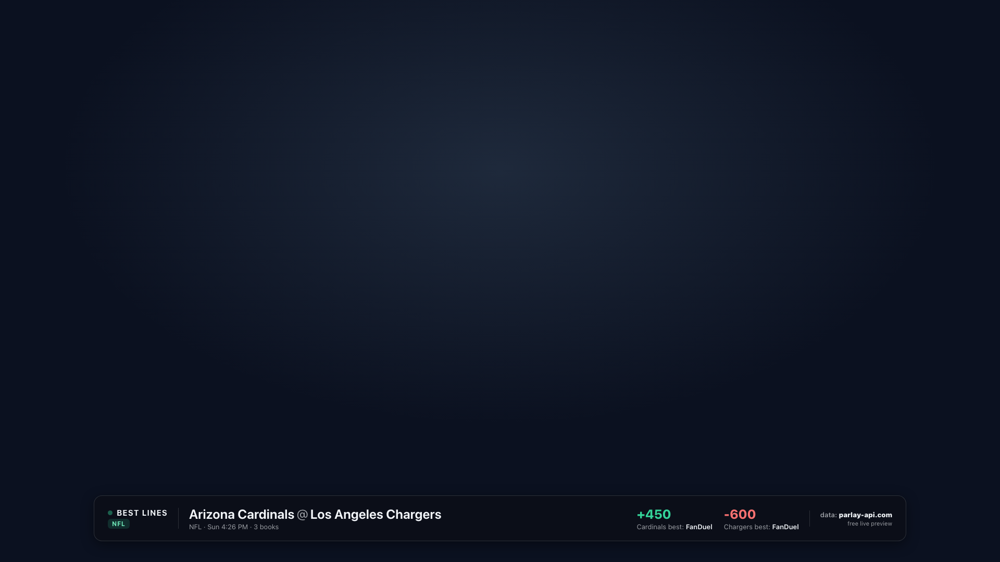

# parlayapi-obs-overlay

A free, single-file OBS browser source for betting streamers: a rotating best-line ticker powered by the keyless live surface at [parlay-api.com](https://parlay-api.com). No API key, no account, no build step. One HTML file.

- Transparent background, broadcast-safe lower third, readable at 1080p
- Rotates through the top ranked games for your sport, showing the best available moneyline on each side and which book has it
- Refreshes once per minute (quota-polite, a single small request)
- Fails quietly: if the feed hiccups it keeps the last good lines on screen and dims the live dot, no error boxes on stream

## OBS setup

1. Download [`overlay.html`](overlay.html) (Raw, then save) anywhere on your machine, for example `C:\overlays\overlay.html` or `~/overlays/overlay.html`.
2. In OBS: Sources, click +, choose Browser.
3. Leave "Local file" unchecked and put a `file:///` URL in the URL field so you can pass options:
   - Windows: `file:///C:/overlays/overlay.html?sport=nfl&theme=dark`
   - macOS: `file:///Users/you/overlays/overlay.html?sport=nfl&theme=dark`
4. Set Width 1920, Height 1080, FPS 30.
5. Recommended: check "Shutdown source when not visible" so the overlay stops polling while the scene is hidden.

The ticker renders as a lower third near the bottom of the 1920x1080 canvas. Move or scale the source like any other.

Tip: to preview outside OBS, open the same URL in a normal browser with `&bg=1` appended. That paints a dark test backdrop behind the transparent overlay. Do not use `bg=1` inside OBS.

## Customization (URL parameters)

| Param | Values | Default | What it does |
|---|---|---|---|
| `sport` | `nfl`, `nba`, `mlb`, `nhl`, `ncaaf`, `ncaab`, `wnba`, `epl`, or any full sport key | all sports | Filter the ticker to one sport |
| `theme` | `dark`, `light` | `dark` | Pill color scheme |
| `speed` | seconds, min 3 | `8` | How long each game stays on screen |
| `max` | 1 to 15 | `10` | How many games rotate |
| `bg` | `1` | off | Test backdrop for previewing outside OBS |

Example: `overlay.html?sport=nba&theme=light&speed=6&max=8`

## Why there is no API key parameter

On purpose. An API key pasted into an OBS browser source URL is visible in your source settings, in settings screen shares, and in "just checking my scenes" moments on stream. Leaked keys get abused and then rotated, which breaks your overlay mid-broadcast. This overlay only calls the keyless public surface, so there is nothing to leak. A `key` or `apiKey` param is ignored if you add one.

## What data you are seeing (honest version)

The keyless live surface is a free preview subset: a handful of books, moneylines, and the top ranked games per sport, refreshed about once a minute. It is real live data, but it is not the full feed. The full ParlayAPI covers 30+ sportsbooks with odds history from 2005, and the free tier includes 1,000 credits per month with no card required. Plans and details: [parlay-api.com/pricing](https://parlay-api.com/pricing).

If you want deeper data on stream (props, spreads, totals, specific books), that requires a key, and keys do not belong in OBS URLs. The right pattern is a tiny local proxy that holds your key server-side. Open an issue if you want a reference proxy and we will prioritize it.

## Compatibility notes

- Requires OBS 28 or newer (the built-in browser is modern Chromium). Older OBS versions with CEF from 2020 or earlier should also work but are untested.
- The overlay makes exactly one HTTPS request per minute to `parlay-api.com/live/api/command_center`. Nothing else is loaded from the network.
- Responsible gambling: this shows odds data, not betting advice. 21+, where legal.

## License

MIT. See [LICENSE](LICENSE).
